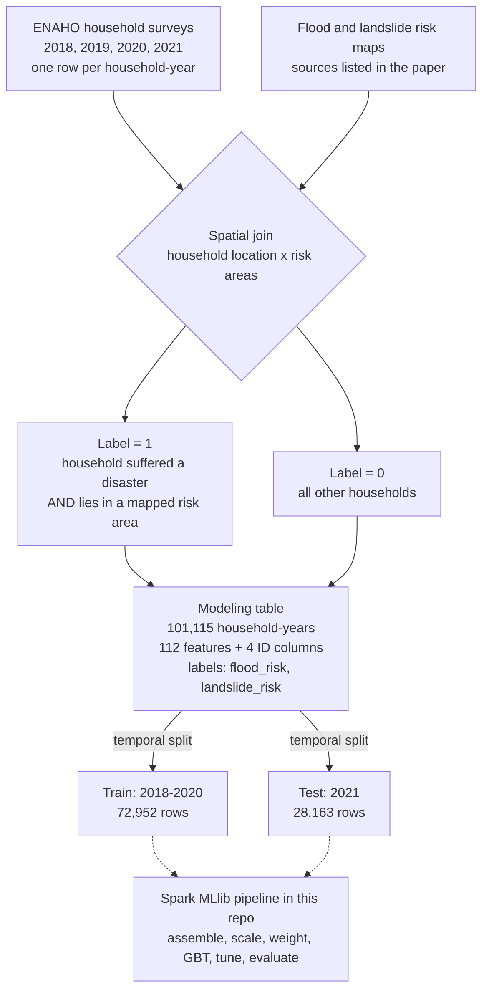

# Peru Disaster-Risk Classifiers — Distributed PySpark / Spark MLlib

A **distributed Spark MLlib** reimplementation of the household **flood** and **landslide** risk
classifiers from:

> Quiliche, R., Maçaira, P., Araujo Baião, F., & Leiras, A. (2025).
> *Identifying final demand points for aid in the aftermath of sudden-onset climate-related disasters
> in Peru: A supervised learning approach.*
> **International Journal of Disaster Risk Reduction, 127, 105593.** https://doi.org/10.1016/j.ijdrr.2025.105593

The original study used single-node `XGBoost` + Bayesian search (`scikit-optimize`) + `SHAP`.
This repository rebuilds the same pipeline to run **distributed on Databricks** (tested on **Free Edition /
serverless**) using the native Spark ML stack.

---

## Where the data comes from (ETL)

The CSVs in this repo are the **end** of an ETL pipeline described in the paper. The steps above the
dashed line were done in the original study; this repo starts from the train/test matrices.



**Why the classes are imbalanced:** a household is positive only if it both suffered a disaster and
sits inside a mapped risk area. Exposed households are few relative to the whole survey sample, so
positives are a small minority:

| Label | Train positives (2018-2020) | Test positives (2021) |
|---|---|---|
| `flood_risk` | 1,020 of 72,952 (1.4%) | 198 of 28,163 (0.7%) |
| `landslide_risk` | 3,931 of 72,952 (5.4%) | 1,581 of 28,163 (5.6%) |

This is why the pipeline uses cost-sensitive weights (`n_neg / n_pos`) and imbalance-aware metrics
(GIBA, G-Mean, MCC) instead of plain accuracy.

## What's here

```
peru-disaster-risk-spark/
├── databricks_distributed_pipeline.ipynb   # the full pipeline (import into Databricks)
├── Databases/TrainTestSplit/               # modeling matrices (temporal split: train < 2021, test = 2021)
│   ├── xf_train.csv  yf_train.csv  xf_test.csv  yf_test.csv   # floods   (112 features + 4 ID cols)
│   └── xl_train.csv  yl_train.csv  xl_test.csv  yl_test.csv   # landslides
├── CITATION.cff
└── requirements.txt
```

> The `x*` files hold 4 ID columns (`conglome, vivienda, hogar, year`) + 112 features.
> The `y*` files hold a single label column (`flood_risk` / `landslide_risk`) aligned **by row order**.

## How the distributed version maps to the original

| Original (pandas / sklearn) | This repo (Spark MLlib) |
|---|---|
| `pd.read_csv` | `spark.read.csv` |
| `RobustScaler` (sklearn) | `pyspark.ml.feature.RobustScaler` (`withCentering=True`) |
| feature matrix `X` | `VectorAssembler` → one `features` vector |
| `scale_pos_weight` | per-row `weightCol` (cost-sensitive learning) |
| `XGBClassifier` | `GBTClassifier` (distributed gradient boosting) |
| `BayesSearchCV` (skopt) | `TrainValidationSplit` + `ParamGridBuilder` (grid search) |
| GIBA / G-Mean / specificity | confusion matrix via Spark `groupBy` |
| SHAP | `.featureImportances` + Spark partial-dependence |
| `pickle.dump` | `model.write().save(...)` |

**Why the tuner changed:** PySpark has no Bayesian hyperparameter search — `pyspark.ml.tuning` provides
only grid/random search (`CrossValidator`, `TrainValidationSplit`). A single-node sklearn tuner cannot
drive a distributed Spark estimator, so the search had to move to the cluster-native one.

## Run it on Databricks

1. **Import the notebook** — Workspace → ⋮ → **Import → File** → `databricks_distributed_pipeline.ipynb`.
2. **Upload the data to a Volume** — Catalog → your catalog/schema → **Create → Volume** (e.g. `thesis_data`),
   then upload the 8 CSVs from `Databases/TrainTestSplit/` into
   `/Volumes/<catalog>/<schema>/thesis_data/Databases/TrainTestSplit/`.
3. **Set `CATALOG` / `SCHEMA` / `VOLUME`** in the notebook's cell 0 (defaults: `workspace` / `default` /
   `thesis_data`). Pick floods or landslides with `LABEL`.
4. **Run top to bottom** on Serverless.

### Serverless notes (baked into the notebook)
- **Scratch path:** MLlib needs `SPARKML_TEMP_DFS_PATH` set to a Volume folder — cell 1 does this.
- **Column names:** region dummies with spaces are sanitized (Delta forbids `` ,;{}()\n\t=``).
- **Model-cache limit:** Spark Connect caps the per-session model cache at 1 GB, so the notebook uses
  `TrainValidationSplit` (fewer models than k-fold CV). If you hit `ML_CACHE_SIZE_OVERFLOW`, run
  `dbutils.library.restartPython()` and re-run cells 1 → 3 → 4.

## Requirements

Spark MLlib is **built into the Databricks runtime** — nothing to install for the core pipeline.
`requirements.txt` lists only optional extras (e.g. `xgboost` for the `SparkXGBClassifier` variant,
which needs a classic cluster). See it for details.

## Citation

See `CITATION.cff`. Please cite the paper (DOI above) if you use this code or data.

## License

All rights reserved by the authors unless a license file is added. Contact the authors before reuse.
