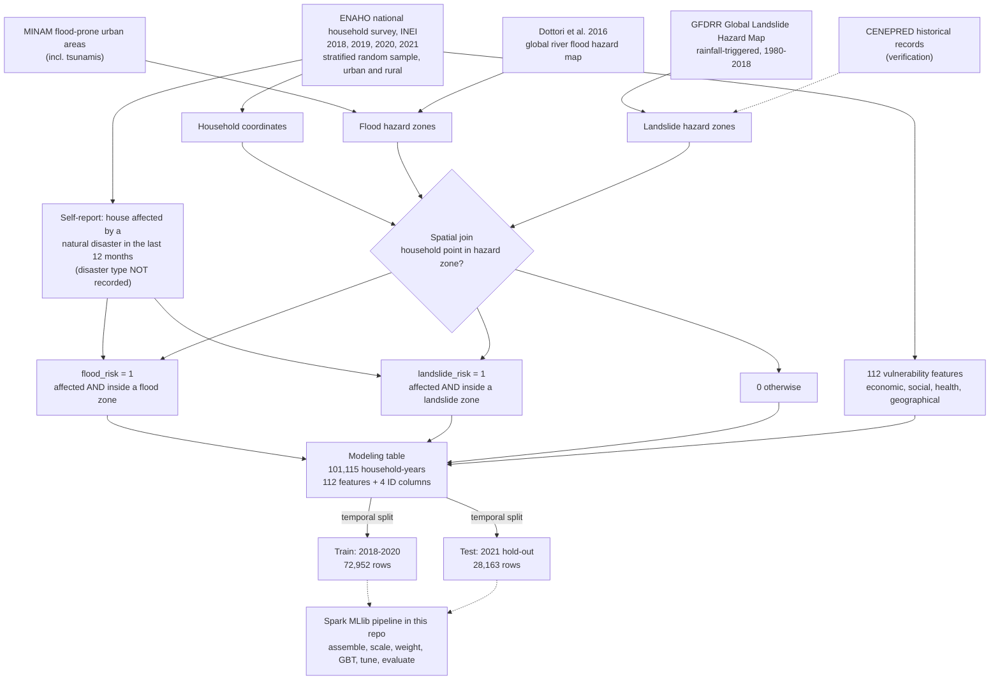
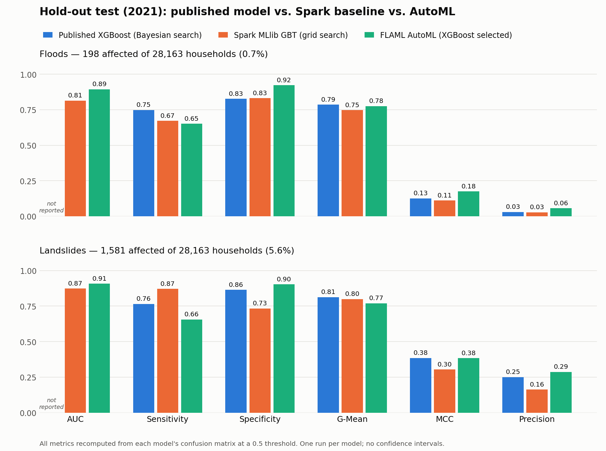

# Peru Disaster-Risk Classifiers — Distributed PySpark / Spark MLlib

A **distributed Spark MLlib** reimplementation of the household **flood** and **landslide** risk
classifiers from:

> Quiliche, R., Maçaira, P., Araujo Baião, F., & Leiras, A. (2025).
> *Identifying final demand points for aid in the aftermath of sudden-onset climate-related disasters
> in Peru: A supervised learning approach.*
> **International Journal of Disaster Risk Reduction, 127, 105593.** https://doi.org/10.1016/j.ijdrr.2025.105593

The original study used single-node `XGBoost` + Bayesian search (`scikit-optimize`) + `SHAP`.
This repository rebuilds the same pipeline to run **distributed on Databricks** (tested on **Free Edition /
serverless**) using the native Spark ML stack.

---

## Where the data comes from (ETL)

The CSVs in this repo are the **end** of an ETL pipeline described in the paper. The steps above the
dashed line were done in the original study; this repo starts from the train/test matrices.



**Why the spatial join is needed:** ENAHO asks whether the house was affected by a natural disaster
in the last 12 months (drought, storm, plague, flood, etc.) but does not record *which* hazard.
Intersecting each household's coordinates with hazard zones attributes the event to floods or
landslides.

**Hazard-zone sources**
- **Floods:** Ministerio del Ambiente (MINAM) flood-prone urban areas, including tsunamis, joined with
  the global flood hazard map of Dottori et al. (2016) to cover rural river floods.
- **Landslides:** Global Landslide Hazard Map from the Global Facility for Disaster Reduction and
  Recovery (GFDRR) — mean annual rainfall-triggered landslide hazard, 1980-2018 — verified against
  historical data from CENEPRED.

**Why the classes are imbalanced:** a household is positive only if it both reports being affected and
sits inside a hazard zone. Few households meet both conditions (1.20% for floods and 5.45% for
landslides over the whole 2018-2021 sample), so positives are a small minority:

| Label | Train positives (2018-2020) | Test positives (2021) |
|---|---|---|
| `flood_risk` | 1,020 of 72,952 (1.4%) | 198 of 28,163 (0.7%) |
| `landslide_risk` | 3,931 of 72,952 (5.4%) | 1,581 of 28,163 (5.6%) |

This is why the pipeline uses cost-sensitive weights (`n_neg / n_pos`) and imbalance-aware metrics
(GIBA, G-Mean, MCC) instead of plain accuracy.

## What's here

```
peru-disaster-risk-spark/
├── databricks_distributed_pipeline.ipynb   # Spark MLlib pipeline, floods + landslides (import into Databricks)
├── automl_flaml_comparison.ipynb           # AutoML (FLAML) on the same data, compared with the Spark baseline
├── figures/                                # hold-out comparison figure + the script that draws it
├── results/holdout_comparison.csv          # all metrics for the three models, both hazards
├── Databases/TrainTestSplit/               # modeling matrices (temporal split: train < 2021, test = 2021)
│   ├── xf_train.csv  yf_train.csv  xf_test.csv  yf_test.csv   # floods   (112 features + 4 ID cols)
│   └── xl_train.csv  yl_train.csv  xl_test.csv  yl_test.csv   # landslides
├── CITATION.cff
└── requirements.txt
```

> The `x*` files hold 4 ID columns (`conglome, vivienda, hogar, year`) + 112 features.
> The `y*` files hold a single label column (`flood_risk` / `landslide_risk`) aligned **by row order**.

## How the distributed version maps to the original

| Original (pandas / sklearn) | This repo (Spark MLlib) |
|---|---|
| `pd.read_csv` | `spark.read.csv` |
| `RobustScaler` (sklearn) | `pyspark.ml.feature.RobustScaler` (`withCentering=True`) |
| feature matrix `X` | `VectorAssembler` → one `features` vector |
| `scale_pos_weight` | per-row `weightCol` (cost-sensitive learning) |
| `XGBClassifier` | `GBTClassifier` (distributed gradient boosting) |
| `BayesSearchCV` (skopt) | `TrainValidationSplit` + `ParamGridBuilder` (grid search) |
| GIBA / G-Mean / specificity | confusion matrix via Spark `groupBy` |
| SHAP | `.featureImportances` + Spark partial-dependence |
| `pickle.dump` | `model.write().save(...)` |

**Why the tuner changed:** PySpark has no Bayesian hyperparameter search — `pyspark.ml.tuning` provides
only grid search (`CrossValidator`, `TrainValidationSplit`). A single-node sklearn tuner cannot
drive a distributed Spark estimator, so the search had to move to the cluster-native one.

**What the search is, exactly:** a **grid search** over 4 combinations (`maxDepth` ∈ {4, 6} ×
`maxIter` ∈ {40, 60}), scored by ROC-AUC on **one random 80/20 train/validation split**. It is not
random search and not cross-validation; k-fold CV overflows the serverless model cache.

## AutoML comparison

`automl_flaml_comparison.ipynb` runs [FLAML](https://github.com/microsoft/FLAML) on the same training
years, class weights, tuning metric and 2021 hold-out. AutoML picks the model family (LightGBM,
XGBoost, random forest, extra trees) and hyperparameters within a time budget, selecting by stratified
5-fold CV. It runs on the notebook's driver, so it is **single-node, not distributed**. Databricks'
built-in AutoML for classification is not used because it needs a classic ML-runtime cluster, which
Free Edition does not offer.

## Results on the 2021 hold-out test set

Three approaches, same 28,163 test households, same class weights (`n_neg / n_pos`), same 0.5
probability threshold. Every metric below is recomputed from each model's confusion matrix with
identical formulas (`figures/make_comparison_figure.py`).



| Hazard | Model | AUC | Sensitivity | Specificity | G-Mean | MCC | Precision | Missed (FN) | False alarms (FP) |
|---|---|---|---|---|---|---|---|---|---|
| Floods | Published XGBoost, Bayesian search | not reported | **0.747** | 0.826 | **0.786** | 0.125 | 0.030 | **50** | 4,858 |
| Floods | Spark MLlib GBT, grid search | 0.815 | 0.672 | 0.831 | 0.747 | 0.111 | 0.027 | 65 | 4,720 |
| Floods | FLAML AutoML (XGBoost selected) | **0.894** | 0.652 | **0.922** | 0.775 | **0.175** | **0.056** | 69 | **2,170** |
| Landslides | Published XGBoost, Bayesian search | not reported | 0.765 | 0.864 | **0.813** | **0.384** | 0.251 | 372 | 3,613 |
| Landslides | Spark MLlib GBT, grid search | 0.873 | **0.871** | 0.733 | 0.799 | 0.303 | 0.163 | **204** | 7,093 |
| Landslides | FLAML AutoML (XGBoost selected) | **0.907** | 0.655 | **0.903** | 0.769 | **0.384** | **0.286** | 545 | **2,585** |

**How each model was tuned**

| | Published | Spark baseline | AutoML |
|---|---|---|---|
| Model | XGBoost | MLlib `GBTClassifier` | chosen by FLAML (XGBoost won both hazards) |
| Search | Bayesian optimization, 50 iterations | grid, 4 combinations | 12-13 configurations in a 300 s budget |
| Validation | stratified k-fold CV | one random 80/20 split | stratified 5-fold CV |
| Objective | GIBA (α = 0.9), favours sensitivity | ROC-AUC | ROC-AUC |
| Compute | single node | Databricks serverless (Spark) | Databricks serverless, driver only |

**What the comparison shows**

- **AutoML ranks households best.** It has the highest AUC for both hazards (0.894 and 0.907) and
  the fewest false alarms: less than half of either other model's for floods, and 28% fewer than the
  published model's for landslides.
- **But it misses more affected households at the 0.5 threshold.** Its sensitivity is the lowest
  of the three (0.65 for both hazards). In this problem a missed household is unmet demand for aid,
  so the higher AUC does not by itself make it the better operational model.
- **The published model is the most balanced.** It was tuned on GIBA, which rewards sensitivity, and
  it has the best G-Mean for both hazards and the fewest missed flood households.
- **The Spark baseline is the weakest ranker,** as expected from a 4-combination grid whose best
  setting sits at the edge of the grid (`maxDepth = 4`, `maxIter = 60` for both hazards). For
  landslides it reaches the highest sensitivity only by flagging 27% of all non-affected households.
- **The differences are mostly about the operating point.** The three models sit at different
  sensitivity/specificity trade-offs; choosing the threshold on validation data (or tuning AutoML on
  GIBA, as the paper did) would be needed for a like-for-like operational comparison.

**Caveats**

- The published confusion matrices are read from Figure 14 of the PUC-Rio thesis version of the
  study, which match the published article. Its hold-out set has the same size and number of
  positives as this repo's test files.
- GIBA is omitted from the table: the value printed in the study could not be reproduced from its
  confusion matrix with this repo's formula, so the two are not comparable.
- One run per model, no confidence intervals. With 198 flood positives, a difference of a few
  households is noise.

**A note on scale:** the data is about 50 MB, so Spark gives no speed advantage here over single-node
tools. The Spark notebook demonstrates the port to a distributed framework and the platform
constraints it surfaces, not a scale-out speedup.

## Run it on Databricks

1. **Import the notebook** — Workspace → ⋮ → **Import → File** → `databricks_distributed_pipeline.ipynb`.
2. **Upload the data to a Volume** — Catalog → your catalog/schema → **Create → Volume** (e.g. `thesis_data`),
   then upload the 8 CSVs from `Databases/TrainTestSplit/` into
   `/Volumes/<catalog>/<schema>/thesis_data/Databases/TrainTestSplit/`.
   Alternatively, upload the CSVs to a Workspace folder and let the notebook's first code cell create
   the Volume and copy them in — edit `SRC` in that cell to your own folder.
3. **Set `CATALOG` / `SCHEMA` / `VOLUME`** in the notebook's cell 0 (defaults: `workspace` / `default` /
   `thesis_data`). Pick floods or landslides with `LABEL`.
4. **Run top to bottom** on Serverless.

### Serverless notes (baked into the notebook)
- **Scratch path:** MLlib needs `SPARKML_TEMP_DFS_PATH` set to a Volume folder — cell 1 does this.
- **Column names:** region dummies with spaces are sanitized (Delta forbids `` ,;{}()\n\t=``).
- **Model-cache limit:** Spark Connect caps the per-session model cache at 1 GB, so the notebook uses
  `TrainValidationSplit` (fewer models than k-fold CV). If you hit `ML_CACHE_SIZE_OVERFLOW`, run
  `dbutils.library.restartPython()` and re-run cells 1 → 3 → 4.

## Requirements

Spark MLlib is **built into the Databricks runtime** — nothing to install for the core pipeline.
`requirements.txt` lists only optional extras (e.g. `xgboost` for the `SparkXGBClassifier` variant,
which needs a classic cluster). See it for details.

## Citation

See `CITATION.cff`. Please cite the paper (DOI above) if you use this code or data.

## License

All rights reserved by the authors unless a license file is added. Contact the authors before reuse.
